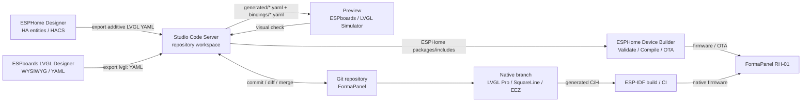

# Актуальные визуальные редакторы и preview-инструменты для ESPHome + LVGL на октябрь 2026

## Краткое резюме

Для **FormaPanel на ESPHome** сейчас нет одного редактора, который одновременно давал бы полноценный WYSIWYG, высокоточную эмуляцию LVGL, прямое редактирование многофайлового репозитория, нативную интеграцию Home Assistant и безопасный round-trip произвольного ESPHome YAML. Наиболее близки к этой цели два проекта: **ESPHome Designer** — благодаря HACS/HA-интеграции, live-состояниям сущностей и импорту/экспорту ESPHome; и **ESPboards LVGL Designer** — благодаря более зрелому именно LVGL-редактору, многим виджетам, multi-screen, импорту существующего `lvgl:` YAML и довольно точному preview. При этом автор ESPHome Designer по-прежнему прямо маркирует LVGL-режим как *Highly Experimental*, тогда как ESPboards ориентирован именно на ESPHome LVGL, но не интегрирован с HA как приложение и остаётся проприетарным веб-сервисом. citeturn310560view2turn582097search0

iturn746209image0

Для **production-проекта FormaPanel** я бы поэтому не делала визуальный редактор владельцем всего YAML. Оптимальный контракт сейчас: визуальный инструмент владеет только UI-слоем, например `ui/generated/*.yaml`; Studio Code Server и Git владеют архитектурой, bindings и ручным кодом; ESPHome Device Builder остаётся источником истины для `Validate/Compile/OTA`. У ESPHome Designer генератор специально описан как additive и не перезаписывает реальный ESPHome YAML автоматически; ESPboards экспортирует только `lvgl:`-блок, оставляя hardware/device config отдельно. Это очень хорошо соответствует такой архитектуре. citeturn310560view0turn288673search3

На **ESP-IDF/native LVGL** выбор заметно лучше. **LVGL Pro Editor** имеет наиболее аккуратную современную архитектуру: XML-проект разбит на отдельные screens/components/widgets/assets, Git встроен в редактор, preview использует реальный LVGL, а экспорт отделяет автоматически перезаписываемые `*_gen.c/.h` от пользовательских файлов, которые генератор не трогает. Для FormaPanel это лучший кандидат на отдельную native ESP-IDF ветку. **SquareLine Studio 1.6.3**, выпущенный 30 октября 2026 года, остаётся очень сильной альтернативой: LVGL 9.6, отдельные файлы экранов, assets, custom variable aliases и CLI-экспорт. citeturn175446search3turn175446search4turn504530search5turn363107search0

Есть важный нюанс с версиями LVGL. **LVGL 10.0 на 31 октября 2026 ещё не выпущен** и официально обозначен как `v10-dev`; LVGL 9.6.0 от 16 сентября 2026 является последним стабильным релизом ветки 9. ESPHome документирует поддержку LVGL 9; переход ESPHome на LVGL 9.5 состоялся в 2026.4. При этом в текущем дереве ESPHome встречаются зависимости как 9.5.0 для IDF component, так и 9.6.0 в PlatformIO-конфигурации, поэтому для FormaPanel правильнее считать **ESPHome API/schema**, а не номер upstream LVGL, контрактом совместимости. Заявления о production-поддержке LVGL 10 у рассмотренных инструментов на текущую дату не подтверждаются. citeturn504530search3turn504530search4turn687521search4turn743603search0turn743603search1

## Сравнение инструментов

| Название | URL | Тип | Поддержка многофайлов / импорт-экспорт | Экспорт форматов | Интеграция с HA | Live preview | Генерация отдельных файлов | Лицензия | Последний релиз | Рекомендация для FormaPanel |
|---|---|---|---|---|---|---|---|---|---|---|
| **ESPHome Designer — koosoli** | https://github.com/koosoli/ESPHomeDesigner | Web + HA custom integration | Multi-page; импорт существующего ESPHome YAML и обратное восстановление поддерживаемых элементов; layout хранится отдельно от ESPHome YAML. Произвольные `lambda/script` round-trip могут восстанавливаться не полностью. citeturn310560view0turn310560view2 | ESPHome LVGL YAML, ESPHome C++ lambda, OEPL JSON/service calls, OpenDisplay JSON. citeturn884168view0 | **Да, через HACS/custom integration**; standalone web также умеет подключаться к HA. citeturn310560view0 | Да; canvas + реальные значения HA entities. citeturn310560view2 | **Частично**: выдаёт additive snippet, но не пишет его автоматически в отдельный YAML проекта. Layout state хранится в `.storage`. citeturn310560view0 | GPL-3.0. citeturn884168view0turn639297view0 | **v1.0.0-rc.48, 17.10.2026**. citeturn884168view2 | **Лучший кандидат для HA-aware слоя**, но LVGL пока experimental; использовать только как generator/UI designer, не как owner всего проекта. |
| **ESPboards LVGL Designer** | https://lvgl.espboards.dev/ | Web | Несколько проектов/экранов; импорт полного ESPHome документа или widget array; экспорт одного/нескольких экранов. citeturn288673search2turn582097search0 | ESPHome `lvgl:` YAML. citeturn288673search3 | Нет нативной интеграции; есть руководства по HA/ESPHome. citeturn582097search4 | **Да**, отдельные Design/Split/Code/Preview modes; renderer сверяется с реальными LVGL renders. citeturn582097search0 | Логически да: экспортируется только UI-блок, однако прямой записи файлов репозитория нет. citeturn288673search3 | Proprietary; бесплатный web editor, отдельные UI packs могут быть платными. citeturn582097search0turn582097search1 | **1.4.0**; точная дата релиза в официальных материалах, найденных при исследовании, **не подтверждена**. citeturn582097search1 | **Лучший WYSIWYG для текущего ESPHome LVGL**; хорош как источник `generated.yaml`. |
| **ESPHome LVGL Simulator — MaxCRRR** | https://github.com/MaxCRRR/ESPHome-LVGL-Simulator | Web / локальный static web | Принимает ESPHome YAML, понимает substitutions, pages, styles/themes, flex/grid, fonts и ряд navigation/script constructs. citeturn882289search0 | Нет: preview/analyser, не основной генератор. citeturn882289search0 | Нет live HA connection. | **Да**, browser simulation, mouse interaction, dummy sensor values. citeturn882289search0 | Нет | MIT. citeturn882289search0 | Формальный latest release **не подтверждён**. | Очень полезен как **второй независимый preview/check** перед сборкой, но не как источник YAML. |
| **EEZ Studio** | https://github.com/eez-open/studio | Desktop app | Проект + generated source tree; LVGL 8/9; widget names уникальны внутри проекта. citeturn288673search7turn812006search7 | C/C++ LVGL; EEZ Flow при необходимости. citeturn288673search7 | Нет | Да, Run/preview; это не ESPHome renderer. citeturn812006search6 | **Да**, build directory содержит `ui.c`, screens/images/actions и др.; destination настраивается. citeturn812006search5 | GPL-3.0-only; generated code принадлежит пользователю, с оговорками для EEZ Flow. citeturn812006search0turn812006search1 | **0.29.0, 02.08.2026**. citeturn371475search1 | Лучший FOSS-вариант для ESP-IDF/LVGL, но не лучший мост в ESPHome YAML. |
| **SquareLine Studio** | https://squareline.io/ | Desktop app | Отдельные screens/components/assets; опция `Save screen separately` специально предназначена для VCS/team workflow. citeturn363107search0turn363107search1 | C/C++ LVGL, MicroPython. citeturn504530search8 | Нет | **Да**, Play Mode без firmware rebuild. citeturn363107search0turn363107search5 | **Да**: отдельный C/H на экран, `images/`, `fonts/`, `components/`, `ui_events.c`, hooks. citeturn363107search0 | Proprietary; бесплатно для personal use, commercial tiers платные. citeturn504530search7turn504530search6 | **1.6.3, 30.10.2026**, LVGL 9.6. citeturn504530search5 | Очень хороший вариант для native ESP-IDF FormaPanel; зрелые assets/naming/export. |
| **LVGL Pro Editor** | https://lvgl.io/pro | Desktop + browser viewer + CLI | **Отличная**: `project.xml`, `globals.xml`, отдельные `screens/`, `components/`, `widgets/`, fonts/images; можно включать другие проекты. citeturn175446search4turn216993search3 | Native LVGL C/H или XML runtime. citeturn175446search3turn216993search1 | Нет | **Да, настоящий LVGL renderer**, inspector, bindings, tests; отдельный PC simulator. citeturn504530search1turn342481search3 | **Лучшее разделение**: `_gen.c/.h` перезаписываются, user skeleton files создаются один раз и сохраняются. citeturn175446search3 | Free для personal/open-source/evaluation; commercial development требует license. citeturn175446search0 | **v2.0.4, 10.09.2026** по GitHub Releases. citeturn371475search0 | **Мой первый выбор для eventual ESP-IDF/native FormaPanel**; в ESPHome напрямую не экспортирует. |

### Совместимость с LVGL 9 и 10

Для текущего FormaPanel на ESPHome критичен именно **ESPHome LVGL YAML schema**, а не возможность редактора генерировать произвольный LVGL C. ESPHome официально говорит о LVGL 9 и предоставляет не все upstream widgets/API, а только свой набор abstractions; поэтому YAML от ESPboards или ESPHome Designer практически применим к ESPHome гораздо напрямую, чем C из SquareLine/EEZ/LVGL Pro. citeturn687521search0

SquareLine 1.6.3 уже прямо поддерживает **LVGL 9.6**. EEZ Studio документирует поддержку 8.x/9.x; release 0.25 добавил 9.3/9.4, а найденные источники для 0.29 не подтверждают полноценный 9.6 target. LVGL Pro в текущей документации показывает проекты с `lvgl_version="9.5.0"`; подтверждения production-таргета 9.6 или 10 в найденной официальной документации нет. LVGL 10 тем временем всё ещё находится в разработке. citeturn504530search5turn371475search5turn216993search3turn504530search3

## Подробные заметки по инструментам

### ESPHome Designer

Это наиболее интересный инструмент именно в контексте **Home Assistant**. Он может работать как отдельное web-приложение или custom integration HA, причём README прямо рекомендует установку через HACS. В редакторе имеется entity picker, а состояния сущностей Home Assistant отображаются непосредственно на canvas. Есть multi-page World View, hierarchy/layers, conditional visibility, MQTT sources и импорт существующего ESPHome кода обратно в дизайнер. citeturn310560view0turn310560view2

Для FormaPanel особенно важна архитектура сохранения. `Save Layout` **не перезаписывает ESPHome YAML**: layout/editor state сохраняется в `/config/.storage/esphome_designer`, а сгенерированный snippet предлагается копировать/мерджить в реальный ESPHome config. Это существенно безопаснее, чем инструмент, который считает себя владельцем всего устройства. Hardware profiles могут храниться отдельно в `/config/esphomedesigner_custom_profiles/*.yaml`. citeturn310560view0

Сам генератор умеет выдавать **C++ display lambda либо LVGL YAML**, assets/images дедуплицируются, а Material Design Icons используются через TTF. Однако автор прямо предупреждает: LVGL-поддержка *Highly Experimental*, и для стабильной эксплуатации рекомендует Native Mode. Кастомные `lambda:` и `script:` могут сохраниться в raw YAML, но визуальный round-trip не гарантирует их полное восстановление. citeturn310560view2

Стабильность идентификаторов улучшалась совсем недавно: RC47 от 10 октября 2026 унифицировал entity-derived sensor IDs через `makeSafeId`, чтобы декларации и ссылки не расходились при длинных entity IDs. Это хороший признак, но официальной гарантии, что **любой вручную заданный widget `id` будет неизменно сохранён через все будущие import/export round-trips**, я не нашла — для production это следует считать «частично подтверждено». citeturn884168view2

Для FormaPanel рабочий процесс я бы сделала таким: ESPHome Designer создаёт/обновляет UI → экспорт попадает вручную или скриптом в `ui/generated/designer.yaml` → Studio Code Server показывает `git diff` → bindings и сложные actions остаются в `ui/bindings/*.yaml` → ESPHome Builder выполняет Validate и Compile. Нельзя разрешать дизайнеру владеть hardware/base package FormaPanel. Такой подход соответствует задокументированной модели additive output самого проекта. citeturn310560view0turn310560view2

Интерфейс/скриншоты находятся непосредственно в репозитории в каталоге `screenshots/`; публичный web editor доступен по `https://koosoli.github.io/ESPHomeDesigner/`. citeturn884168view0turn342481search18

### ESPboards LVGL Designer

Если отбросить HA entity binding и оценивать именно **ESPHome LVGL UI authoring**, ESPboards сегодня выглядит более зрелым. Он поддерживает несколько проектов и экранов, top/bottom layers, flex/grid, TabView/TileView и широкий набор widgets; редактор имеет Design, Split, Code и Preview modes. Импорт понимает как полный ESPHome YAML, так и простой массив widgets, а экспорт может сформировать только текущий экран либо несколько экранов как `lvgl.pages`. citeturn582097search0turn288673search2

Особенно полезно, что экспорт содержит **только `lvgl:`**, не затрагивая Wi-Fi, display driver, touchscreen и прочую аппаратную конфигурацию. Для FormaPanel это почти идеальная граница ответственности: generated UI можно хранить в отдельном include/package. citeturn288673search3

Preview не является буквально браузерной сборкой той же библиотеки LVGL, но разработчики утверждают, что canvas реализует правила отрисовки LVGL и сравнивается pixel-by-pixel с реальными ESPHome renders; часть тестов достигает zero-pixel difference. Поэтому это хороший layout-preview, но окончательным renderer остаётся реальная прошивка ESPHome. citeturn582097search0

Assets поддержаны заметно лучше, чем в большинстве ESPHome-специфичных инструментов: есть Google Fonts browser с preview реального размера, Material Design Icons, а импорт/экспорт умеет работать с top-level `image:` definitions и дедуплицировать изображения. citeturn582097search0turn288673search2

С точки зрения Git есть ограничение: проекты автоматически сохраняются в **browser local storage**, а не непосредственно в рабочий каталог репозитория. Публичный GitHub repository проекта сейчас служит в основном для issues/feature requests; код дизайнера объявлен proprietary. Поэтому source-of-truth для FormaPanel лучше оставить в Git YAML, а проект ESPboards рассматривать как инструмент authoring/import/export. citeturn288673search2turn582097search0

Официальные preview-изображения интерфейса:  
`https://lvgl.espboards.dev/img/guide/designer-canvas.png`  
`https://lvgl.espboards.dev/img/guide/designer-export-yaml.png` citeturn746209image0turn746209image1

### ESPHome LVGL Simulator

`MaxCRRR/ESPHome-LVGL-Simulator` интересен не как редактор, а как **независимый быстрый renderer существующего YAML**. Он принимает целый ESPHome config и понимает substitutions, named colors, theme/style definitions, flex/grid, pages/navigation, fonts, MDI, `gfonts://`, многие widgets и `!lambda` placeholders. Dynamic values эмулируются placeholders или случайными значениями. citeturn882289search0

Это хорошо подходит для CI-подобного workflow FormaPanel: после изменений в Studio Code можно скопировать/подать итоговый UI в simulator, посмотреть экраны без OTA, затем уже запускать ESPHome Validate/Compile. Но этот renderer написан отдельно от ESPHome и не является proof того, что ESPHome schema корректна; последнее слово остаётся за `esphome config/compile`. citeturn882289search0turn687521search0

Проект может работать с GitHub Pages либо полностью локально через простой HTTP server. Для offline preview можно положить MDI TTF/WOFF2 рядом с приложением. Опциональный Claude analyser требует API key; сама визуальная симуляция без него работает. На GitHub Pages AI analyser отключён из-за browser CORS. citeturn882289search0

Для FormaPanel я бы использовала его именно как **secondary preview**, особенно полезный при review pull request: generated YAML → simulator → screenshot/regression check. Лицензия MIT. citeturn882289search0

### EEZ Studio

EEZ Studio — наиболее сильный полностью open-source desktop-кандидат. Проект GPL-3.0, работает на Windows/macOS/Linux и поддерживает LVGL 8.x/9.x. Generated code пользователь может использовать независимо; авторы отдельно поясняют ownership generated source. citeturn288673search7turn812006search1

Для native ESP-IDF FormaPanel он способен генерировать C/C++ UI в отдельный destination directory. Widget должен иметь уникальное имя в проекте, если к нему нужно обращаться из логики. Это намного лучше подходит к C API, чем автоматически меняющиеся anonymous IDs. citeturn812006search5turn812006search7

Есть, однако, два существенных ограничения. Во-первых, `.eez-project` остаётся основным design source и менее удобен для code review, чем текстовый XML LVGL Pro или раздельные screen files SquareLine. Во-вторых, assets обычно генерируются как C source; запрос на более развитый external-flash resource export существовал как feature request, что показывает ограничение текущей asset pipeline для больших font/image наборов. citeturn812006search3

Кроме того, в начале 2026 был зафиксирован случай, когда export для LVGL 9 использовал compatibility API LVGL 8 и создавал проблемы в pure-C ESP-IDF; это относилось к EEZ 0.25.1 и не следует автоматически переносить на текущую 0.29.0, но для FormaPanel я бы обязательно включила compile-test generated C против конкретного ESP-IDF/LVGL target в CI. citeturn812006search4turn371475search1

### SquareLine Studio

SquareLine сейчас особенно интересен тем, что версия **1.6.3 вышла буквально 30 октября 2026 и добавила LVGL 9.6**. Это делает его самым очевидным production-ready visual editor среди традиционных C-code generators для последней стабильной ветки LVGL. citeturn504530search5turn504530search4

Его export architecture хорошо подходит FormaPanel. Полный template project обычно создаётся один раз, после чего можно экспортировать только UI files; другие части firmware не перезаписываются. На C/C++ выходе создаются отдельные каталоги `screens`, `images`, `fonts`, `components`, а также `ui.c`, `ui.h`, helpers и hooks. Начиная с 1.5.2 каждый экран имеет отдельные C/H files. citeturn363107search0

Для разделения generated/manual code имеются `ui_events.c` и `ui_comp_hook.c`. Это не так строго и элегантно, как `_gen`/user separation LVGL Pro, но позволяет держать custom logic вне основной генерации. citeturn363107search0turn363107search3

Стабильность ID/имен решена хорошо: Project Settings содержит schemes именования, а `Custom variable alias` позволяет задать semantic C pointer name независимо от layout hierarchy. Для FormaPanel я бы ввела обязательное соглашение вроде `fp_<screen>_<role>` и никогда не ссылалась из backend на auto-generated names. citeturn363107search1turn363107search2

Git workflow тоже заметно улучшился: опция **Save screen separately** прямо описана как средство для repository/version control и параллельной работы над разными экранами. Есть command-line export, поэтому generated UI можно проверять или обновлять автоматизированно, хотя CLI требует заранее активированной лицензии. citeturn363107search1turn363107search4

Assets включают PNG/JPG и fonts, имеется Font Maker, image dithering и несколько способов размещения image data — в C или через filesystem/external storage в зависимости от выбранного режима. citeturn363107search6turn363107search1

Для **ESPHome** я бы SquareLine не использовала: конвертация generated C обратно в ESPHome YAML создаст новый слой сложности. Для отдельной **FormaPanel ESP-IDF** ветки — напротив, это один из трёх лучших вариантов. citeturn504530search8turn687521search0

### LVGL Pro Editor

С архитектурной точки зрения это сейчас наиболее интересный инструмент для долгоживущего native проекта. UI source полностью текстовый: `project.xml`, `globals.xml`, `screens/*.xml`, `components/*.xml`, `widgets/*.xml`, `fonts/`, `images/`; проект может подключать другие component libraries через `<folders>`. Такая структура естественно ложится на Git и merge requests. citeturn175446search4turn216993search3

Editor сам построен как VS-Code-подобная среда: file navigation, terminal, debugger, Git integration и Open VSX extensions. Есть drag-and-drop Design mode и XML mode, причём оба редактируют одни и те же файлы. Preview выполняется реальным LVGL renderer и поддерживает inspector, data bindings, animations и UI tests. citeturn504530search1

Для FormaPanel особенно ценно разделение generated/manual code. Файлы с окончанием `_gen.c`/`_gen.h` всегда генерируются заново и не должны редактироваться. Параллельно создаются user files только при их отсутствии; туда можно помещать custom handlers, observers и wrappers. Это практически идеальная модель для автоматического regeneration без потери ручного кода. citeturn175446search3

Assets также структурированы нормально для repository workflow: fonts и images входят в проект; при export генерируется initialization layer, а file-based assets могут оставаться внешними и передаваться через asset path. Figma Flow умеет раскладывать экспорт по `screens`, `components`, `images` и сохраняет metadata для стабильных имён между re-export. citeturn175446search3turn175446search6

Git здесь не «добавлен сбоку»: LVGL Pro прямо позиционирует текстовые XML projects как подходящие для version control; online viewer умеет открывать проект из GitHub, а CLI способен validate/generate/test в CI. citeturn216993search1

Последний GitHub release — v2.0.4 от 10 сентября 2026. При этом часть download pages LVGL на момент исследования всё ещё отображала v1.2.1; для версии я считаю GitHub Releases более актуальным первичным источником. citeturn371475search0turn175446search1

Главное ограничение для текущего FormaPanel: LVGL Pro экспортирует **нативный LVGL C/XML, не ESPHome YAML**. Поэтому использовать его имеет смысл только после сознательного перехода интерфейсного слоя FormaPanel на ESP-IDF/native LVGL либо при поддержании двух разных frontend implementations. citeturn175446search3turn687521search0

## Рекомендуемый workflow для FormaPanel

Для текущей ESPHome-ветки я бы закрепила следующую структуру репозитория:

```text
formapanel-rh01/
├── firmware/
│   └── esphome/
│       ├── formapanel-rh01.yaml
│       ├── hardware/
│       │   └── rh01.yaml
│       ├── ui/
│       │   ├── generated/
│       │   │   ├── home.yaml
│       │   │   ├── climate.yaml
│       │   │   └── settings.yaml
│       │   ├── bindings/
│       │   │   ├── home.yaml
│       │   │   ├── climate.yaml
│       │   │   └── settings.yaml
│       │   ├── styles.yaml
│       │   └── navigation.yaml
│       └── components/
└── assets/
    ├── fonts/
    └── images/
```

Это не требование ESPHome, а предлагаемая архитектура FormaPanel. ESPHome позволяет адресовать widgets по `id`, а сами visual editors умеют экспортировать `lvgl:`-фрагменты, поэтому UI layout и behavioural bindings разумно разделить. citeturn687521search0turn288673search3



Для generated YAML я бы ввела три жёстких правила. Во-первых, **любой виджет, который используется вне generated файла, получает вручную закреплённый semantic `id`**; не следует связывать бизнес-логику с `lv_slider_5` или `button_17`. ESPHome непосредственно использует IDs для automation references. citeturn687521search0 Во-вторых, файлы под `ui/generated/` считаются disposable и никогда не содержат ручной код. В-третьих, любой re-export проходит через `git diff` и ESPHome Validate до commit.

Для native branch правила можно сделать ещё строже: LVGL Pro XML или SquareLine project становится source-of-truth для layout; generated C помещается в `firmware/idf/generated/ui/`; ручная логика находится в `firmware/idf/src/ui_bindings/`. LVGL Pro уже нативно следует почти точно такой модели `_gen` + user files. citeturn175446search3

## Home Assistant, CORS, токены и локальный режим

Именно ESPHome Designer имеет здесь явное преимущество. В standalone GitHub Pages варианте его документация требует указать Home Assistant URL, создать **Long-Lived Access Token** и разрешить origin дизайнера в HA CORS. Официальный пример:

```yaml
http:
  cors_allowed_origins:
    - https://koosoli.github.io
```

Это документировано самим проектом. citeturn639297view0turn639297view2

Для разработки можно запускать frontend локально, например на `http://localhost:5174` или через Python HTTP server; при таком standalone-подключении к HA всё равно используется HA URL + Long-Lived Access Token, а cross-origin доступ должен быть разрешён соответствующим origin. citeturn310560view0

Для **HACS/HA integration** архитектура предпочтительнее: frontend обслуживается самим custom component/panel и layout сохраняется внутри HA. Документация не требует в этом режиме вручную вводить внешний Long-Lived Token или добавлять `koosoli.github.io` в CORS; это логично следует из того, что приложение запускается как HA integration, однако отдельного утверждения «token никогда не нужен» в README я не нашла, поэтому это следует считать выводом из архитектуры, а не документированной гарантией. citeturn310560view0

ESPboards к HA API напрямую не подключается, поэтому token/CORS для обычного проектирования не нужны; Home Assistant появляется уже через сгенерированный ESPHome configuration и native ESPHome API. citeturn582097search4

LVGL Pro, SquareLine и EEZ работают с UI source/C-code и Home Assistant не знают вообще; HA binding для них является ответственностью приложения FormaPanel/ESP-IDF. Поэтому в native архитектуре можно полностью избежать browser tokens и CORS, но придётся самостоятельно реализовать transport/state layer к HA. citeturn175446search3turn504530search8turn288673search7

## Выбор и внедрение

Для FormaPanel я бы разделила выбор по двум траекториям.

**Текущая ESPHome firmware:** основной визуальный инструмент — **ESPboards LVGL Designer**, потому что его output максимально близок к ESPHome schema и он не пытается владеть hardware configuration; **ESPHome Designer** установить через HACS и использовать там, где критичны HA entity picker/live entity preview и быстрое создание bindings. Для сложных экранов полезно прогонять итоговый YAML ещё и через **ESPHome LVGL Simulator**, но никогда не считать его заменой ESPHome Validate. citeturn288673search3turn310560view2turn882289search0

**Будущая native ESP-IDF firmware:** первым кандидатом я бы выбрала **LVGL Pro**, особенно если FormaPanel предполагается как долгоживущий продукт с несколькими экранами, reusable components, Git review и CI; его multi-file XML и generated/user separation здесь объективно лучше всего совпадают с требованиями проекта. **SquareLine Studio** стоит держать вторым кандидатом: на сегодня он лучше документирован именно для LVGL 9.6 и имеет зрелую работу с assets и C source export. **EEZ Studio** — достойная open-source альтернатива, если GPL desktop tool и отсутствие коммерческой лицензии важнее polished Git/source architecture. citeturn175446search4turn175446search3turn504530search5turn812006search1

Перед стандартизацией я бы сделала небольшой **FormaPanel UI compatibility suite**: несколько screens с flex/grid, `top_layer`, TabView/TileView, Cyrillic fonts, PNG assets, MDI, stateful switch, slider, `checked/disabled`, navigation и несколькими `homeassistant.action`. Один и тот же набор прогнать через ESPboards import/export, ESPHome Designer import/export и ESPHome Builder, после чего сравнить YAML через Git. Это даст практический ответ на наиболее важный вопрос — не «кто поддерживает LVGL», а **какой редактор стабильно сохраняет именно тот поднабор ESPHome LVGL, который использует FormaPanel**. ESPHome сам реализует только подмножество LVGL widgets/properties, поэтому такой regression corpus существенно полезнее формальной совместимости с upstream LVGL. citeturn687521search0

Полезные первичные ресурсы для дальнейшей работы: официальный ESPHome LVGL reference — `https://esphome.io/components/lvgl/`; ESPHome Designer — `https://github.com/koosoli/ESPHomeDesigner`; ESPboards — `https://lvgl.espboards.dev/`; ESPHome LVGL Simulator — `https://github.com/MaxCRRR/ESPHome-LVGL-Simulator`; LVGL Pro — `https://lvgl.io/pro`; SquareLine — `https://squareline.io/`; EEZ Studio — `https://github.com/eez-open/studio`; upstream LVGL 9.6/10 migration documentation — `https://lvgl.io/docs/open/`. citeturn743603search4turn884168view0turn582097search1turn882289search0turn216993search1turn504530search7turn288673search7turn504530search3