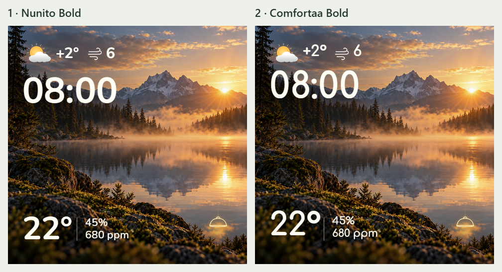

# RH-01: сравнение шрифтов и выбор Comfortaa

Дата: 01.11.2026. По запросу владельца подготовлены два варианта текущей
главной страницы. **APPROVED: выбран вариант 2 — Comfortaa Bold.**
Источник решения — прямой ответ владельца на показанное сравнение:
«Вариант 2 — Comfortaa Bold», затем поручение «продолжай».
Для главной принят показанный вариант Comfortaa: вес 700 для крупных
цифр/погоды и 500 для малого текста. Повторное согласование семейства не нужно.

- [Nunito 480×480](../../ui/previews/rh01-font-nunito-2026-11-01.png).
- [Comfortaa 480×480](../../ui/previews/rh01-font-comfortaa-2026-11-01.png).

## Что одинаково

Фон, PNG-иконки, геометрия из `packages/rh01-ui.yaml`, значения `08:00`,
`+2°`, ветер `6`, `22°`, `45%`, `680 ppm`. Кегли: часы 72, комнатная
температура 64, погода 30, малый климатический текст 21 px. В обоих вариантах
крупные надписи используют вес 700, малые — 500. Координаты и размеры
объектов не подгонялись отдельно; различие видимых базовых линий/пропорций
связано с метриками самих шрифтов.

## Источник и способ получения

Nunito Bold/Medium взяты из существующего `assets/source/fonts`.
Comfortaa — настоящий variable TTF из
[официального Google Fonts](https://github.com/google/fonts/tree/main/ofl/comfortaa),
Git blob `8b8e5f81bf740a8154bb6cd9f4eee5ac4bda6b18`, с SIL OFL 1.1.
Через уже имеющийся fontTools подготовлены веса 700 и 500 без установки
системных шрифтов и SDK. Копия TTF, лицензия и SHA-256 сохранены локально в
игнорируемом `reports/local/font-comparison/`.

Это предварительный browser canvas render с настоящими TTF и геометрией
нашей прошивки, не дополнительное испытание Comfortaa на физическом LCD.
Оба отдельных PNG имеют 480×480, общий лист — 1008×548; совпадение фоновой
области и наличие различий текста проверены. Рабочие YAML/ресурсы прошивки
не переключались на новый шрифт.

Следующий шаг реализации — перенести выбранную Comfortaa в постоянные assets с отдельными OFL/manifest,
проверить русские glyphs и границы динамических значений, затем получить
настоящий host/LVGL кадр и при необходимости сверить с панелью.
Показанные макеты сами по себе не меняли рабочую прошивку; перенос и native
проверка выполняются в отдельной сессии Astra по
[плану HA-функциональности](../05-roadmap/ha-functional-ui-plan.md).
