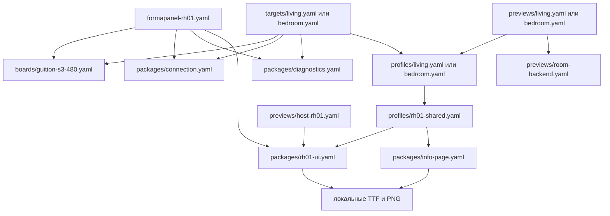

# Компоновка исходников ESPHome / LVGL

Срез: **01.11.2026**. Этот документ описывает существующие файлы, а отдельно
помеченные предложения — будущие изменения. Основной исходник интерфейса —
многофайловый ESPHome YAML в Git checkout. Workshop собирает его напрямую;
экспорт/импорт всей прошивки и отдельный C-проект для host preview не нужны.

Рабочий стек зафиксирован в [отчёте Workshop](../06-validation/ha-workshop-2026-10-31.md):
ESPHome 2026.10.1, LVGL 9.5.0, ESP-IDF 5.5.6. У исходного RH-01
`min_version` пока 2026.10.0; это нижняя граница схемы, а не другая проверенная
сборочная версия. У новых device/host входов нижняя граница — 2026.10.1.

## Существующее дерево

```text
config/workbench-targets.json          # RH-01, living, bedroom: пары entry
firmware/esphome/
  formapanel-rh01.yaml                 # исходный одностраничный device entry
  boards/guition-s3-480.yaml           # ESP32-S3, RGB LCD, GT911, backlight
  packages/
    connection.yaml                  # Wi-Fi, API, OTA, logger, safe_mode
    diagnostics.yaml                 # heap/PSRAM, uptime, Wi-Fi, reset reason
    rh01-ui.yaml                     # fonts + images + LVGL home + local lamp
    info-page.yaml                   # общая info-страница и навигационный patch
  profiles/
    rh01-shared.yaml                  # общие demo defaults + home + info
    living.yaml                      # room_label, общий профиль
    bedroom.yaml                     # room_label, отличающиеся demo-значения
  targets/{living,bedroom}.yaml        # device entry каждой комнаты
  previews/
    host-rh01.yaml                    # исходный RH-01: host + 2 captures
    room-backend.yaml                 # общий host backend: 3 captures
    {living,bedroom}.yaml             # тот же комнатный profile + host backend
    README.md
  secrets.yaml.example               # пример имён, не действующие credentials
assets/source/fonts/                 # Nunito TTF, OFL
assets/source/backgrounds/            # master фон
assets/generated/480x480/rh01-*.png    # background, weather, wind, lamp on/off
tools/render_rh01.py                  # воспроизводимая генерация RH-01 assets
tools/ha-workbench/                   # browser UI и сервер сборки
```

`ui/tokens/` и старые дизайн-макеты существуют, но `rh01-ui.yaml` не импортирует
их автоматически. В текущем runtime координаты, цвета и размеры шрифтов
объявлены непосредственно в YAML. Отдельных `resources.yaml`, `theme.yaml`,
`behavior/mock.yaml`, `behavior/ha.yaml` пока нет.

## Граф включений



Каждый entry компилируется отдельно. Два комнатных profiles сегодня используют
**одну композицию home с разными числами**, а не две независимые главные страницы.
RH-01 остаётся исходным одностраничным вариантом и не включает `info-page.yaml`.
Его device и host entry отдельно содержат demo substitutions: изменение числа
только в `formapanel-rh01.yaml` не изменит host-копию. Для текущей разработки
комнат предпочтительнее living/bedroom: device и preview берут один profile.

## Ответственность слоёв

| Слой | Что в нём находится | Что в него не добавлять |
|---|---|---|
| Board | MCU/framework, flash/PSRAM, display/touch IDs, GPIO, backlight | Комнатные значения, рисунок страницы |
| Device entry | Уникальное имя устройства, board, connection/diagnostics, выбранный profile | Копию всех widgets |
| Room profile | Выбор общих пакетов, подпись комнаты, demo overrides | GPIO и host capture logic |
| Shared UI | Fonts/images, геометрия и виджеты home, общая info-страница | Секреты и придуманные HA entity IDs |
| Host entry/backend | `host`, memory display, capture scenario, удаление touch input | Wi-Fi, GT911, LEDC, OTA и физическую диагностику |
| Workshop wrapper | Абсолютные пути assets/build, ссылка на настоящий entry | UI, собственное толкование packages или копию проекта |

Комнатные значения находятся в `profiles/living.yaml` и `bedroom.yaml`.
Общая home-композиция — `packages/rh01-ui.yaml`; дополнительная страница —
`packages/info-page.yaml`. Аппаратный профиль типовой Guition, а проверка
фактической ревизии, ориентации, питания и touch на панели ещё обязательна.

## Правила packages и параметров

ESPHome выполняет слияние пакетов сам. По [официальным правилам](https://esphome.io/components/packages/)
словари объединяются по ключам, компоненты списков — по ID, прочие списки
соединяются; main-конфигурация переопределяет package substitutions.
При расширении LVGL-дерева явно использовать `!extend`, как в `info-page.yaml`,
а для удаления унаследованного ключа — `!remove`, как для host touchscreens.

Практические правила проекта:

1. Сначала подключать объявляющий пакет, затем его расширения. Сейчас
   `rh01-shared.yaml` включает home, затем info, который расширяет home/лампу.
2. Ключи mapping внутри `packages:` — названия включений для читателя, не
   отдельные пространства ID. Все IDs внутри одного target должны быть уникальны.
3. Для точечной правки указывать ID страницы и ID вложенного widget через
   `!extend`; не копировать всю страницу ради нового текста или события.
4. `!extend` не означает отмену прежнего обработчика. После изменения событий
   проверять итоговую схему и поведение, чтобы не получить два действия на касание.
5. Выбирать начальную страницу явно. Общий info-пакет на `lvgl.on_boot`
   показывает `rh01_home`; не полагаться на порядок страниц после list merge.
6. Внешний wrapper вправе переопределять пути. Комнатные substitutions
   переопределяют общие demo defaults; значения времени и текста заключать
   в кавычки. Текст не должен требовать glyphs, отсутствующих в выбранном subset.
7. `!include` разрешается относительно содержащего его YAML. Пути `font.file`
   и `image.file` считаются от **основного entry**, которым может быть wrapper.

Нужные имена substitutions: `formapanel_asset_dir`, `preview_build_path`,
`formapanel_build_path`, `room_label`, `demo_time`, `demo_outdoor_temperature`,
`demo_wind`, `demo_room_temperature`, `demo_room_humidity`, `demo_room_co2`.
Исходный device RH-01 использует также `device_name`, `friendly_name` и не
объявляет `formapanel_build_path`; Workshop задаёт ему `esphome.build_path`
непосредственно в wrapper.

## Ресурсы и secrets

| Основной entry | Default `formapanel_asset_dir` |
|---|---|
| `firmware/esphome/formapanel-rh01.yaml` | `../../assets` |
| `firmware/esphome/targets/*.yaml` | `../../../assets` |
| `firmware/esphome/previews/*.yaml` | `../../../assets` из backend/host entry |
| Wrapper Workshop | Абсолютный `<workspace>/assets` |

В `rh01-ui.yaml` используются готовые 480×480 exports и локальные Nunito
Bold/Medium TTF. Не масштабировать master на ESP32 во время работы.
Иконки — RGB565 с alpha channel, фон — непрозрачный RGB565; подписи и числа
остаются LVGL labels. Изменение исходной графики требует повторить
`tools/render_rh01.py` и проверить соответствующий PNG export.

`connection.yaml` ссылается на `wifi_ssid`, `wifi_password`,
`formapanel_api_key`, `formapanel_ota_password`. В установленном checkout
они находятся в **`firmware/esphome/packages/secrets.yaml`**, рядом с пакетом.
Этот файл игнорируется Git; реальные значения и BIN с provisioning не
публикуются. По [loader ESPHome 2026.10.1](https://github.com/esphome/esphome/blob/2026.10.1/esphome/yaml_util.py)
при отсутствии secrets-файла возле включённого YAML есть fallback к secrets
возле основного entry. У Workshop entry находится в приватном `/data/configs`,
поэтому нельзя рассчитывать на произвольный secrets возле repository root.
Пример `secrets.yaml.example` содержит имена ключей, а не готовый API key.

Host previews не подключают `connection.yaml` и не требуют secrets.
Нынешняя сборка читает локальный Git checkout. Это не Remote Packages:
при будущем переходе на Git packages действуют отдельные ограничения на
`!secret` и разрешение путей ресурсов; такой переход пока не выполнен.

## Контракт IDs: home, info и capture backend

| ID / маркер | Кто объявляет и кто использует |
|---|---|
| `panel_display` | Board или host memory display; UI и snapshot actions |
| `panel_touch` | Только board; host удаляет `lvgl.touchscreens` |
| `panel_ui` | Общий `lvgl` component в RH-01 UI |
| `rh01_home` | Главная страница; info возвращается сюда, backend восстанавливает её |
| `rh01_lamp_button` | Home button; info добавляет `on_long_press` |
| `rh01_lamp_image` | Изображение лампы; локальный toggle и native capture меняют `src` |
| `rh01_lamp_on`, `rh01_lamp_off` | Image resources, используемые обоими сценариями |
| `panel_info` | Общая info-страница; переход из home и третий snapshot |
| `panel_info_font`, `info_*` | Общие ресурсы/виджеты info; не переобъявлять в home |
| `RH01_NATIVE_PREVIEW_COMPLETE` | INFO-маркер завершения, ожидаемый worker |

Обычное касание лампы переключает только локальную картинку. На living/bedroom
удержание открывает info, «Назад» возвращает home. Capture backend вызывает
смену картинок и страниц программно: он не доказывает работу этих touch событий.
Видимая кнопка/изображение не являются подключённым к HA светильником.

Host RH-01 выдаёт `rh01-on.bmp`, `rh01-off.bmp`. Комнатный backend добавляет
`info.bmp`. Worker находит все BMP и сохраняет PNG; произвольную новую страницу
он сам не обходит. После первого LVGL flush backend ждёт 250 ms для кадра;
это сценарий статического demo, не универсальная готовность асинхронных данных.
Для будущих mock/HA входов потребуется явный сценарий готовности/состояния.

## Добавить страницу, комнату или новую home-композицию

**Дополнительная страница:** создать UI-пакет с уникальным page ID и widget
prefix; включить его в общий профиль либо только нужную комнату. Добавить
переход и возврат, затем `page.show` + snapshot в выбранный host scenario.
Убедиться, что subset шрифта включает новые подписи. Изменение общего пакета
проверять на living и bedroom, исходный RH-01 — отдельно как baseline.

**Новая комната с нынешним home:** добавить `profiles/<room>.yaml` по образцу
living/bedroom, device entry в `targets/` и host entry в `previews/`. Оба entry
подключают один profile, host — ещё и `room-backend.yaml`. Имена ESPHome и
build paths должны быть отдельными. Добавить `id`, `label`, `firmware`, `preview`
в [manifest](../../config/workbench-targets.json). Отдельно проверить config,
native кадры, общую страницу и сборку BIN; наличие manifest не подтверждает build.

**Другая главная композиция:** сейчас fonts/images и home находятся в одном
`rh01-ui.yaml`. Для реального разделения сначала вынести общие resources в
отдельный пакет с сохранением прежнего entry/IDs и сравнением baseline PNG.
Затем новый профиль сможет выбрать свой home-пакет и общие resources/info,
не подключая старый home второй раз. Это точка расширения, а не уже выполненный
рефакторинг. Новый home сохраняет контракт таблицы выше либо получает свой
navigation/capture backend. Одной смены имени файла или числа недостаточно.

## Поведение, HA и проверки: факт и план

**Существует:** фиксированные demo substitutions, локальный image toggle,
shared info и host capture, соединение устройства Wi-Fi/API/OTA и диагностика.
Результаты native/firmware сборок приведены в отчётах; аппаратная приёмка —
отдельный этап. Настоящие room sensor subscriptions и HA light actions
в текущих profiles отсутствуют.

**Предлагается:** отдельные adapters `mock` и `ha` с одинаковыми sensor/script
IDs; общая UI-логика обновляет labels и состояния через этот контракт.
Mock публикует значения и имитирует on/off/pending/unavailable/error без HA.
HA adapter получает подтверждённое состояние и вызывает согласованное действие,
не подменяя его успехом локальной анимации. Папки/файлы behavior пока не созданы;
пример следующего этапа — [эффективный цикл разработки](../02-research/effective-ui-development-2026-11.md).

Workshop использует постоянные per-kind/per-profile wrapper и metadata,
отдельные job snapshots/artifacts; подробности и измерения —
[incremental report](../06-validation/ha-workshop-incremental-2026-11-01.md).
Изменение YAML, встроенного PNG или TTF требует build/restart host.
Runtime mock/HA state updates без повторной компиляции — цель следующего слоя.

Текущий [GitHub workflow](../../.github/workflows/verify.yml) генерирует assets,
выполняет `tools/validate.py` и Python unit tests. Он **не** делает матрицу
ESPHome config/firmware/native builds и не устанавливает прошивки. Validator
проверяет заданные файлы/ресурсы, а не весь YAML graph или все Markdown-ссылки.
До расширения CI конкретный target проверяется Workshop/HA, а затем на панели.

См. также [ADR-0004](adr/0004-browser-workshop.md),
[browser runbook](../02-research/ha-browser-workflow.md),
[RH-01 implementation](../03-design/rh01-implementation.md) и
[HA contract draft](ha-contract.md).
